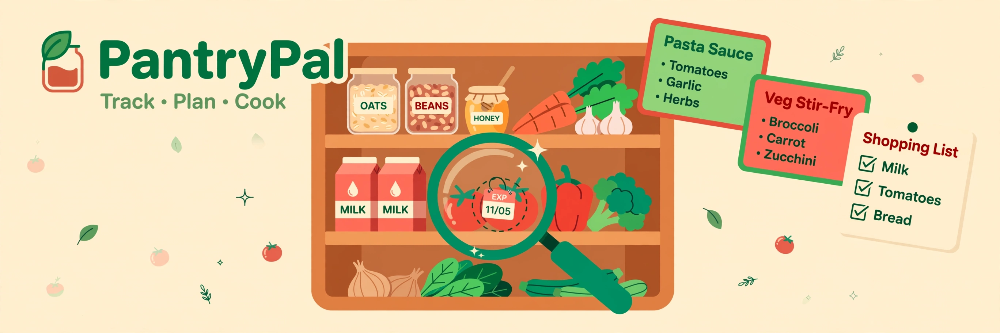

# PantryPal



**Your pantry, minus the waste.** PantryPal tracks what's in your kitchen and when it expires, then suggests recipes from a bundled offline cookbook — ranked by how many ingredients you already have, with a boost for recipes that rescue items about to expire. Missing ingredients become a shopping list in one tap.

100% offline. No accounts, no API keys, no network calls.

## Features

- **Pantry tracking** — items with quantity, unit, category, and expiry dates.
- **Expiry alerts** — "expiring soon" and "expired" lists, most urgent first; a "needs attention" banner on the pantry tab.
- **Recipe suggestions** — a bundled dataset of 12 original recipes, scored by:
  - **Coverage** — % of ingredients already in your pantry (fuzzy matching: "red bell peppers" matches "bell pepper", plurals handled).
  - **Urgency** — recipes using items expiring soon rank higher.
  - Expired items never count as "on hand".
- **Recipe detail** — "you have" vs "you need" ingredient lists, steps, prep time.
- **Shopping list** — one tap turns all missing ingredients (deduplicated, tagged with their recipe) into a check-off list; manual items supported too.

## Project structure

```
PantryPal/
├── Package.swift                  # Swift Package Manager — pure-logic library + tests
├── Sources/PantryPal/             # Business logic (Foundation only, no UI imports)
│   ├── PantryItem.swift           # Item model + ExpiryStatus (expired/expiringSoon/fresh)
│   ├── Pantry.swift               # In-memory pantry, search, expiry queries, waste summary
│   ├── Recipe.swift               # Recipe model
│   ├── RecipeDataset.swift        # Bundled offline cookbook (12 original recipes)
│   ├── IngredientMatcher.swift    # Fuzzy pantry↔ingredient name matching
│   ├── RecipeSuggester.swift      # Coverage + urgency scoring & ranking
│   └── ShoppingList.swift         # Check-off list + generation from missing ingredients
├── App/                           # SwiftUI iOS app (Xcode target, not part of `swift test`)
│   ├── PantryPalApp.swift         # @main entry point
│   ├── ContentView.swift          # TabView: Pantry · Recipes · Shopping
│   ├── ViewModels.swift           # @Observable view models + JSON file persistence
│   ├── PantryListView.swift       # Expiry alerts + searchable item list
│   ├── PantryFormView.swift       # Add/edit item form
│   ├── RecipeListView.swift       # Ranked suggestions + recipe detail
│   └── ShoppingListView.swift     # Check-off shopping list
├── Tests/PantryPalTests/          # XCTest suite for all business logic
└── docs/hero-banner.png
```

## Run the logic tests (no Xcode needed)

```bash
swift test
```

## Open the iOS app in Xcode

1. Open Xcode → **File → New → Project → iOS → App**, name it `PantryPal`.
2. **File → Add Package Dependencies → Add Local…** and select this folder.
3. In the app target's **Frameworks, Libraries, and Embedded Content**, add `PantryPal`.
4. Drag the `App/` folder's `.swift` files into the Xcode project.
5. Build & run on a simulator (iOS 17+).

> The `App/` folder is intentionally outside the SwiftPM build: `swift test` compiles and tests only the pure logic, while the SwiftUI layer is written for Xcode on a Mac (Swift 5.9+, iOS 17).

## Tech stack

- Swift 5.9+, SwiftUI, `@Observable`
- Swift Package Manager (logic as a versioned library target)
- XCTest for the logic suite
- JSON file persistence in the app's documents directory

## License

MIT — see [LICENSE](LICENSE).
